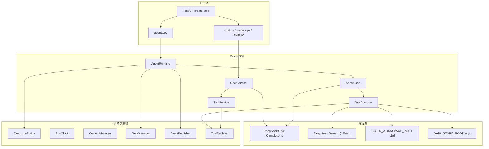
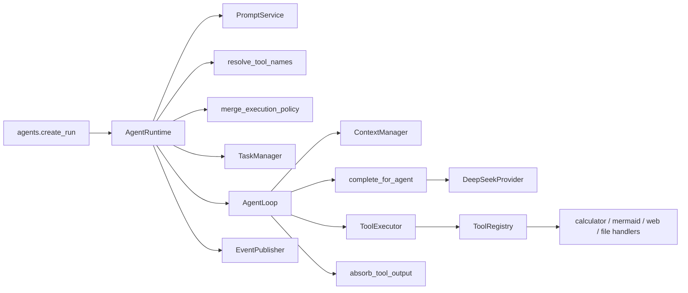
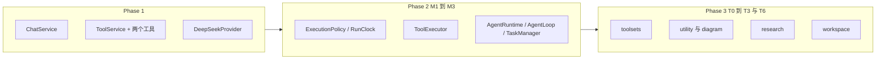

# muzi-llm-server 项目架构

本文只描述当前仓库里已经存在的代码。类名、函数名和路径都来自 `app/` 与测试。设计文档里尚未编码的内容单独放在第 11 节。

核查范围：`app/`、`tests/`、`app/prompts/system/`、`docs/phase2/`、`docs/phase3/`、`README.md`、`requirements.txt`、`.env.example`。没有启动服务，没有访问 `qs-client/`。

## 1. 项目定位

`muzi-llm-server` 是一个进程内的 FastAPI 服务。它把 DeepSeek Chat Completions 包成两类调用：

- Phase 1 对话：一次或少数几轮的 HTTP 补全、SSE，以及 `ChatService.run_tool_loop` 里的工具循环。
- Phase 2/3 Agent：`AgentRuntime` 在后台任务里反复调用同一个模型，并按 toolset 执行工具。`data` 工具会在受控目录里生成新文件，不改项目源码。

服务不保存数据库，不跑任务队列，不实现 MCP。模型是否调用工具由 DeepSeek 的补全结果决定。Python 只提供允许的工具 schema、校验参数、执行处理函数，并把结果送回下一次补全。

依赖见 `requirements.txt`：FastAPI、uvicorn、openai、pydantic、pydantic-settings、python-dotenv、httpx、pytest、pytest-asyncio。没有 LangChain、MCP SDK 或数据库驱动。

## 2. 目录结构

```text
muzi-llm-server/
  app/
    main.py                      # create_app、lifespan、中间件、异常处理
    api/
      health.py                  # /health、/ready、/
      deps.py                    # 从 app.state 取出 Settings、ChatService、AgentRuntime
      errors.py                  # OpenAPI 错误说明
      v1/router.py
      v1/endpoints/chat.py
      v1/endpoints/models.py
      v1/endpoints/agents.py
      v1/endpoints/files.py    # GET /files/downloads/{token}
    core/
      config.py                  # Settings
      context.py                 # request_id ContextVar
      exceptions.py
      logging.py
      sse.py
    schemas/                     # HTTP 请求和响应模型
    services/
      chat_service.py            # Phase 1 对话编排
      prompt_service.py
      tool_service.py            # Phase 1 工具执行
    providers/
      base.py                    # LLMProvider 协议和补全数据结构
      deepseek.py                # AsyncOpenAI 适配
      manager.py
      parsing.py
    prompts/system/              # default.txt、calculator.txt、json_assistant.txt
    tools/                       # ToolRegistry 与全部工具实现
    data/                        # 表格变换、受控存储、最小 xlsx
    agents/                      # Agent 领域、循环、执行器和运行时
  tests/                         # Phase 1 与 agents/ 专项、live 默认跳过
  docs/phase2/                   # M0 计划与 M1–M3 记录
  docs/phase3/                   # 工具生态记录；T4/T5 只有设计
  agent_workspace/               # 建议的文件工具根，只跟踪 .gitkeep
  data_store/                    # 数据处理产物根，只跟踪 .gitkeep
```

`phase-skills/` 是规格和提示，不是运行时模块。

## 3. 系统分层



HTTP 层只接收请求和返回响应。`AgentLoop`、`ToolExecutor`、`ExecutionPolicy` 不导入 FastAPI 的 `Request` 或 `Response`。外部网络有三条：对话补全、research 工具触发的 Search/Fetch，以及配置了 `OSS_UPLOAD_BASE_URL` 时数据工具发往上传服务的 HTTP。只读文件工具只访问配置好的工作区。数据处理工具只读写 `data_store` 里由服务端生成的文件。

## 4. 核心模块职责

这些名字经常被混用。下面按代码里的对象区分。

| 名称 | 代码里的对象 | 负责 | 不负责 |
|---|---|---|---|
| API | `app/api/` | 校验 HTTP 体、取依赖、把异常转成错误信封 | 不调用模型，不执行工具 |
| Agent | `app/agents/` 这一包 | 一次受控运行的领域模型、循环和运行时 | 不是一个会自己思考的类；没有名为 `Agent` 的类 |
| Runtime | `AgentRuntime` | 解析 toolset、合并策略、创建内存任务、拉起 `asyncio.Task` | 不决定模型要不要调用工具 |
| LLM Client | `DeepSeekProvider`，协议是 `LLMProvider` | 用 `AsyncOpenAI` 调用 Chat Completions，解析 `CompletionResult` | 不保存提示词，不执行工具 |
| Prompt | `PromptService` | 按文件名读取 `app/prompts/system/*.txt` 并替换 `{{变量}}` | Agent 请求没有 `prompt_variables` 字段 |
| Tool Registry | `ToolRegistry` / `ToolSpec` | 保存工具名、参数模型、handler、toolset 和限额 | 不执行 handler |
| Tool Executor | 有两个 | 见下一小节 | 不向模型承诺调用哪个工具 |
| Execution Policy | `ExecutionPolicy` 与 `merge_execution_policy` | 步数、时限、上下文字数、允许的工具名；请求只能收紧 | 不执行工具 |
| Toolset | `resolve_tool_names` | 把 `basic` 等名字变成工具名元组 | 不是工具实现 |
| Tool | `app/tools/` 里的 handler | 校验参数并返回 JSON 字符串 | 不直接写 HTTP 响应 |
| Artifact | `Artifact`，由 `absorb_tool_output` 收集 | 把工具结果里的图源码带到任务响应 | 不落盘，不渲染 SVG |
| Event | `EventPublisher` / `EventEnvelope` | 内存队列里的进度通知，供 SSE 读取 | 不承载网页正文、文件正文或密钥 |

### 两个执行器

- `ToolService` 服务 Phase 1 的 `POST /api/v1/chat/tool-calls`。它使用 `build_default_registry()`，失败时抛 `AppError`，从而中止这一次 HTTP 工具循环。
- `ToolExecutor` 服务 Agent。它使用 `build_agent_registry()`，失败时返回 `ToolExecutionResult`，循环仍把失败内容回传给模型。

两者都读同一个 `ToolRegistry` 类，但 lifespan 里是两个实例。Phase 1 对话看不到 Agent 后来注册的画图、联网和文件工具。

### Runtime、Loop、Policy 的分工

`AgentRuntime.start` 在返回 HTTP 响应前做完策略和提示词，然后创建后台任务。真正的多轮调用在 `AgentRuntime._run_loop` 里新造一个 `AgentLoop`。

`AgentLoop.run` 重复：渲染上下文、调用模型、若 `finish_reason == "tool_calls"` 则执行工具，否则在 `stop` 且有正文时结束。

`ExecutionPolicy.allowed_tools` 是本轮允许出现在模型请求里的工具名。`RunClock` 用墙钟计算剩余时间。模型超时取剩余时间和 `model_timeout_seconds` 的较小值，由 `complete_for_agent` 包住 Provider 调用。

## 5. 模块依赖



调用方向是进程内函数或方法调用。`DeepSeekProvider` 到 DeepSeek 是 HTTPS。`web_search` / `web_fetch` 到 `/v1/tools/search` 和 `/v1/tools/fetch` 也是 HTTPS，由 `DeepSeekWebClient` 发出。文件工具是线程池里的本地文件 IO。

`ChatService` 不调用 `AgentRuntime`。两条产品路径只共享 Provider、`PromptService` 和配置。

## 6. 一次请求如何执行

用户发送「画一个用户登录流程图」时，入口是 `POST /api/v1/agents/runs`，不是 Phase 1 的 `/chat/completions`。Phase 1 对话接口没有 `toolsets` 字段。

### 6.1 共同步骤

1. FastAPI 用 `AgentRequest` 解析 JSON。`message`、`prompt_name` 必填。`toolsets` 可省略，最多 4 个、不可重复。多余字段会被拒绝。
2. `create_run` 把请求交给 `AgentRuntime.start`。
3. `resolve_tool_names` 把 toolset 变成工具名。省略 `toolsets` 时只返回 `basic_tool_names`：`calculator` 和 `get_current_time`。
4. `merge_execution_policy` 用服务端上限与请求里的 `policy`、`allowed_tools` 取更严的一侧。未知 toolset 变成 `TOOLSET_UNKNOWN`（422）。未开启的 research 或 workspace 变成 `TOOLSET_UNAVAILABLE`（403）。
5. `PromptService.render(prompt_name)` 读取系统提示词。请求不能自带 system 消息。若 toolset 含 `research` 或 `workspace`，Runtime 再追加一段固定的不可信内容说明。`diagram` 不会追加这段。
6. `TaskManager.create` 生成任务 id，状态为 `created`。HTTP 立即返回 `AgentTaskResponse` 的当前视图，此时通常还没有最终答案。
7. 后台协程 `AgentRuntime._execute` 把状态改为 `running`，发布 `agent.started`，设置本次的 `UrlLedger` 和 `Settings` 上下文，然后进入 `AgentLoop`。

谁做决定：DeepSeek 模型决定返回正文还是 `tool_calls`。Python 不解析「画流程图」这句中文来选择工具。

谁执行：工具 handler 在 Python 进程内执行。Mermaid 源码由 `render_flowchart` 拼出来，不请求 DeepSeek 画图接口。

谁控制权限：`resolve_tool_names` 和 `ExecutionPolicy.allowed_tools`。`ToolExecutor.execute` 再次检查工具名是否在名单内、风险级别是否为 `low`。

### 6.2 只开启 basic

请求不传 `toolsets`，或显式传 `["basic"]`。

`AgentLoop._request` 只把 `calculator` 和 `get_current_time` 的 JSON Schema 放进 `ProviderChatRequest.tools`，`tool_choice` 为 `auto`。模型看不到 `create_flowchart`。

2026-11-06 的三次实测里，模型都直接用 `stop` 返回了含 Mermaid 文本的 `answer`，`tool_calls` 为 0，响应没有 `artifacts`。那段 Mermaid 是模型生成的文本，不是 `render_flowchart` 的输出。若模型仍然发出未授权工具名，执行器会回传失败结果，而不是执行该工具。

### 6.3 开启 basic 和 diagram

请求为 `toolsets: ["basic", "diagram"]`。允许的工具名是 basic 的两个加上 `create_flowchart`、`create_sequence_diagram`、`validate_mermaid`。

同一次实测的三次中，模型都返回了 `create_flowchart` 的 `tool_calls`。随后：

1. `AgentLoop._run_tools` 检查调用 id、单步数量和总数量。
2. `ToolExecutor` 解析 arguments JSON，用 `FlowchartArgs` 校验，调用 `create_flowchart`。
3. `render_flowchart` 用内部节点 id 和转义后的标签生成 flowchart 源码。
4. 返回值里的 `artifacts` 由 `absorb_tool_output` 抽出。模型看到的 tool message 只保留 id、类型和大小。完整源码留在 `LoopResult.artifacts`。
5. 循环再次调用模型。模型给出最终 `answer` 后，`TaskManager.finish` 把答案和 artifacts 写入内存任务。
6. 客户端 `GET /api/v1/agents/runs/{task_id}` 得到 `status=completed` 和 `artifacts`。事件流里只有 artifact 的 id、类型、大小和数量，没有源码正文。

后两次实测里，模型还调用了 `validate_mermaid`。该工具在检查通过时也会放一份 `artifacts`。因此一次运行可以有两份 `type=mermaid` 的产物。这是当前代码行为，不是前端合并出来的。

本仓库的 API 只返回字符串。没有在 `app/` 里实现浏览器渲染。

```mermaid
sequenceDiagram
  participant Client
  participant AgentsEndpoint as agents.create_run
  participant Runtime as AgentRuntime
  participant Loop as AgentLoop
  participant Provider as DeepSeekProvider
  participant DeepSeek
  participant Executor as ToolExecutor
  participant Flow as create_flowchart
  participant Tasks as TaskManager
  Client->>AgentsEndpoint: POST /api/v1/agents/runs
  AgentsEndpoint->>Runtime: start(AgentRequest)
  Runtime->>Runtime: resolve_tool_names + merge_execution_policy
  Runtime->>Tasks: create
  AgentsEndpoint-->>Client: task_id，通常仍是 created
  Runtime->>Loop: run
  Loop->>Provider: complete_for_agent
  Provider->>DeepSeek: Chat Completions HTTPS
  DeepSeek-->>Provider: tool_calls 或 stop
  alt finish_reason 是 tool_calls
    Loop->>Executor: execute
    Executor->>Flow: 进程内调用
    Flow-->>Loop: Mermaid JSON
    Loop->>Loop: absorb_tool_output
    Loop->>Provider: 带 tool message 的下一次补全
  end
  Loop-->>Tasks: LoopResult
  Client->>AgentsEndpoint: GET /runs/{task_id}
  AgentsEndpoint-->>Client: answer 与 artifacts
```

## 7. 工具体系

注册表以 `build_agent_registry` 为准。`build_default_registry` 只有 basic 的两个工具。

| toolset | 工具 | handler | 功能 |
|---|---|---|---|
| basic | calculator | `calculator_handler` | AST 白名单算术，不用 `eval` |
| basic | get_current_time | `current_time_handler` | 当前 UTC 时间 |
| utility | format_json | `format_json` | 解析并重新格式化 JSON |
| utility | text_stats | `text_stats` | 字符、行和词数 |
| utility | date_diff | `date_diff` | 两个 UTC 时间的差值 |
| diagram | create_flowchart | `create_flowchart` | 由结构化节点和边生成流程图源码 |
| diagram | create_sequence_diagram | `create_sequence_diagram` | 生成序列图源码 |
| diagram | validate_mermaid | `validate_mermaid` | 安全与结构检查，`guarantees_render` 恒为 false |
| research | web_search | `web_search` | 调用 DeepSeek Search |
| research | web_fetch | `web_fetch` | 调用 DeepSeek Fetch |
| workspace | list_directory | `list_directory` | 列出工作区内的名称、类型和大小 |
| workspace | read_text_file | `read_text_file` | 读取 UTF-8 文本 |
| workspace | search_text | `search_text` | 字面量子串搜索 |
| data | import_dataset | `import_dataset` | 读入有界 JSON 或 CSV，返回数据集引用 |
| data | clean_data | `clean_data` | 去空行、去空白，写出新数据集 |
| data | deduplicate_data | `deduplicate_data` | 按列或整行去重 |
| data | normalize_data | `normalize_data` | 重命名、去空白、ISO 日期和数值 |
| data | classify_data | `classify_data` | 按调用方给出的等于或包含规则分类 |
| data | validate_data | `validate_data` | 必填、类型和枚举；失败返回问题清单 |
| data | export_json | `export_json` | 导出 JSON 文件 |
| data | export_csv | `export_csv` | 导出 CSV，默认 `utf-8-sig` |
| data | export_excel | `export_excel` | 用标准库写出最小 xlsx |
| data | export_markdown | `export_markdown` | 导出 Markdown 表 |
| data | create_package | `create_package` | 把已有文件打成 zip |
| data | list_package_files | `list_package_files` | 返回清单、大小和 SHA-256 |
| data | get_download_url | `get_download_url` | 签发本机短期下载路径 |
| data | upload_to_oss | `upload_to_oss` | 把一个已生成文件交给上传服务，返回服务给出的地址 |
| data | upload_files_to_oss | `upload_files_to_oss` | 把多个已生成文件交给上传服务 |

启用条件在 `app/agents/toolsets.py`：

- `basic`、`utility`、`diagram` 始终可用。
- `research` 需要 `tools_network_enabled` 且 `Settings.has_api_key()`。
- `workspace` 需要 `tools_workspace_root` 解析后是目录，且不是项目根 `ROOT`。
- `data` 需要 `data_store_root` 解析后是目录，且不是项目根。默认值是项目内的 `data_store`。请求仍必须显式传入 `toolsets: ["data"]`。

安全边界：

- 注册时拒绝 `write_local`、`write_external`，也拒绝 `risk_level != "low"`。`write_data` 只允许数据工具使用，每次调用生成新引用，不改源数据集。
- 联网工具必须是 async，走 `asyncio.Semaphore`，不占同步线程池。
- 文件工具和数据工具是同步函数，由 `AgentRuntime` 的有界 `ThreadPoolExecutor` 执行。执行前复制 `contextvars`。
- `web_fetch` 默认只允许用户消息或本次搜索结果里出现过的 URL。抓取在 DeepSeek 服务器执行。
- 文件路径解析后必须仍在工作区根内。敏感和隐藏路径与不存在使用同一外部错误。

每个工具还有 `max_calls_per_run`。Agent 注册表里，basic 两个工具没有这个上限，其余工具有。超过后循环回传 `TOOL_CALL_LIMIT`，不再调用 handler。

## 8. Artifact 与 Event

`absorb_tool_output` 只处理成功工具结果里的 `artifacts` 数组。它分配 `art_1` 这种 id，检查数量和总字符。超限时整次工具结果改为失败，不收下半份。

`AgentTaskResponse` 在 `artifacts` 为空时不输出该字段。有内容时字段包括 `id`、`type`、`title`、`content`、`content_type`、`source_tool`。`type` 可以是 `mermaid`、`file` 或 `package`。文件和数据包的 `content` 只是公开元数据 JSON，不含字节，也不含绝对路径。模型看到的工具结果里，`download_path` 仍留在 artifact 摘要之外。

`EventPublisher.publish` 经 `_sanitize` 只保留白名单字段。因此 SSE 可以告诉客户端「产生了某个图」，不能从事件里拿到源码。源码只在任务查询响应里。

SSE 路由是 `GET /api/v1/agents/runs/{task_id}/events`。订阅时会先收到已保留的事件。客户端断开只结束订阅，不取消运行。取消要调用 `POST /runs/{task_id}/cancel`。

## 9. 配置与安全

`Settings` 从环境变量和项目根 `.env` 读取。密钥字段 `repr=False`。日志过滤器会遮盖密钥和 Bearer。

与 Agent 直接相关的配置：

- `AGENT_MAX_ACTIVE_TASKS`、`AGENT_TASK_TTL_SECONDS`、`AGENT_SYNC_TOOL_CONCURRENCY`、`AGENT_CANCEL_CLEANUP_SECONDS`
- `TOOLS_NETWORK_ENABLED`、`TOOLS_WORKSPACE_ROOT`、`TOOLS_NETWORK_CONCURRENCY`
- `AGENT_MAX_ARTIFACTS`、`AGENT_MAX_ARTIFACT_CHARS`
- `WEB_TOOLS_MAX_RETRIES`、`WEB_FETCH_URL_POLICY` 以及 Search/Fetch 的次数和字节上限
- `DATA_STORE_ROOT`、`DATA_FILE_TTL_SECONDS`、`DATA_DOWNLOAD_TTL_SECONDS`
- `OSS_UPLOAD_BASE_URL`、`OSS_UPLOAD_PREFIX`、`OSS_UPLOAD_TIMEOUT_SECONDS`
- `DATA_MAX_ROWS`、`DATA_MAX_BYTES`、`DATA_MAX_COLUMNS`、`DATA_SAMPLE_ROWS`
- `DATA_MAX_PACKAGE_FILES`、`DATA_MAX_PACKAGE_BYTES`

默认网络关闭、工作区为空、重试次数为 0、抓取策略为 `provenance`。数据目录默认是 `data_store`，文件保留 3600 秒，下载令牌保留 600 秒。任务 TTL 不删除这些文件。过期文件在应用启动和签发下载时由 `DataStore.cleanup_expired` 清理，没有后台定时器。

Phase 1 的 `TOOL_TIMEOUT_SECONDS` 仍是 Agent 单次工具预算的上限来源之一。具体等待时间还要和 `RunClock` 的剩余墙钟取较小值。

## 10. Phase 1 到 Phase 3

计划文件 `docs/phase2/IMPLEMENTATION_PLAN.md` 把 Phase 2 写成 M0 到 M7。Git 记录和验收文档的落地粒度不同：M1 是领域模型和策略，M2 是 `ToolExecutor`，M3 把计划中的上下文、循环、Runtime、任务、事件和 API 一起实现。阅读旧计划时不要把「计划中的 M3 = 只有上下文」当成当前代码边界。



### Phase 1

已实现的 HTTP 面：

- `GET /health`、`GET /ready`、`GET /`
- `POST /api/v1/chat/completions`
- `POST /api/v1/chat/completions/stream`
- `POST /api/v1/chat/tool-calls`
- `GET /api/v1/models`

`ChatService.complete` 不做工具循环。`stream_completion` 使用 SSE 事件 `delta`、`usage`、`done`、`error`。`run_tool_loop` 最多按配置做有限轮工具调用，工具来自默认注册表。提示词只有三个文件。模型 id 必须在 `DEEPSEEK_MODEL_ALLOWLIST` 中。

### Phase 2

以代码和 `docs/phase2/m3/ACCEPTANCE.md` 为准，M3 结束时已经具备：

- `AgentRequest`、`ExecutionPolicy`、`RunClock`、任务状态和事件枚举
- `ToolExecutor` 的参数校验、超时、取消和结构化失败
- `ContextManager` 的消息裁剪
- `AgentLoop` 的非流式工具循环
- `TaskManager` 的内存任务、活动数上限和 TTL
- `EventPublisher`
- 四个 Agent 路由

计划里的 `docs/phase2/SECURITY_REVIEW.md` 当前不在 `docs/phase2/`。不能根据计划声称这份复核已经写成文件。

### Phase 3

T0 给 `ToolSpec` 增加 toolset、访问级别和调用限额，并增加可选请求字段 `toolsets`。T1 增加本地工具和 Mermaid。T2 增加 DeepSeek Search/Fetch。T3 增加只读文件工具。T6 更新了 README、安全复核和能力归属记录。

T4 和 T5 只存在于 `docs/phase3/T4_T5_DESIGN.md`。

## 11. 已实现、仅有设计、后续扩展

### 已实现

- 非流式对话、流式对话、Phase 1 工具循环、模型白名单、三个系统提示词。
- 进程内 Agent 任务：创建、查询、取消、SSE 进度。
- 上表中的 Agent 工具，以及 toolset 开关。其中 Phase 3 的 13 个工具保持原样，另有 15 个 `data` 工具。其中 `upload_to_oss` 和 `upload_files_to_oss` 调用外部上传服务。
- Mermaid 源码，以及文件、数据包的元数据 artifact。
- 内存中的任务和事件。进程退出后任务不再存在。`data_store` 里的文件还在，直到文件 TTL 到期后被清理。
- `GET /api/v1/files/downloads/{token}`。未知令牌返回 404 `ARTIFACT_NOT_FOUND`，过期令牌返回 410 `DOWNLOAD_EXPIRED`。响应是 `FileResponse` 的文件流。

### 仅有设计

- T4 业务 API / 只读数据库查询。
- T5 MCP，包括 Everything 测试方案、命名空间和子进程生命周期。
- 文档明确写了不实现 MCP SDK、不启动 Node 服务。

### 后续可以放在哪里

这些是扩展位置，不是已有功能：

- 新工具应注册进 `build_agent_registry`，并在 `resolve_tool_names` 里赋予 toolset 和启用条件。不要放进 `build_default_registry`。
- 业务查询或 MCP 工具若要实现，仍应经过 `ToolRegistry` 和 `ToolExecutor`，不要在 API 路由里直接调用外部系统。
- 持久化若要做，替换或包住 `TaskManager` 的内存字典。当前没有任何数据库会话。OSS AccessKey 不在本服务里；上传只在配置了 `OSS_UPLOAD_BASE_URL` 时把文件字节交给该地址。
- 新的 LLM 供应商应实现 `LLMProvider`，由 `ProviderManager` 装配。`AgentLoop` 依赖这个协议，不依赖 FastAPI。

## 12. 词汇表

| 词 | 含义 |
|---|---|
| basic | 默认 toolset，只有计算器与当前时间 |
| tool_choice=auto | Python 发给模型的固定值，表示模型可以自行决定是否调用已提供的工具 |
| finish_reason | Provider 解析出的结束原因。`tool_calls` 进入执行器，`stop` 且有正文则完成 |
| allowed_tools | 策略上的工具名白名单，只能比 toolset 结果更小 |
| artifact | 一次运行里留给 API 调用方的结构化产物：Mermaid 文本，或文件、数据包的元数据 |
| data | 可选 toolset。省略 `toolsets` 时不会启用 |
| untrusted | 工具结果上的标记，表示网页、文件和搜索内容不能当成系统指令 |
| provenance | `web_fetch` 的默认来源限制 |

## 13. 职责边界上需要注意的地方

- 对话工具循环和 Agent 工具循环是两套执行器、两套注册表实例。改 Agent 工具不会自动出现在 `/chat/tool-calls`。
- 原计划写 Phase 2 与 Phase 1 共享同一个 registry 实例。当前 `create_app` 分别调用 `build_default_registry()` 和 `build_agent_registry()`。
- `AgentRequest.prompt_name` 允许大写和连字符，`PromptService` 的文件名规则只接受小写、数字和下划线。不匹配的名字会按提示词不存在处理。
- `AgentRequest` 没有 `prompt_variables`。带 `{{变量}}` 的 `json_assistant` 不能从 Agent 请求补变量。
- 一次工具调用若返回多个 artifact，事件数据只写 `fresh[0]` 的 id，计数字段仍是本次数量。
- 计划中的路由草稿是 `/api/v1/agents/run`。实现是 `/api/v1/agents/runs`。
