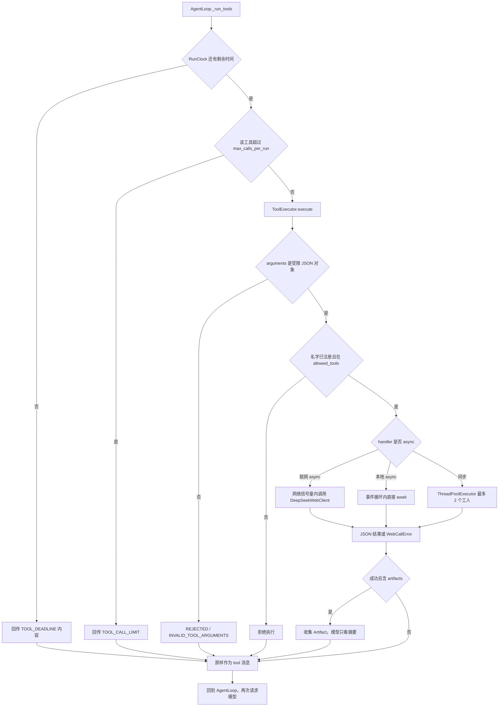

# muzi-llm-server 运行时数据流

本文只描述当前代码里的信息流动。模块职责和目录见 `docs/PROJECT_ARCHITECTURE.md`。

## 1. 请求从哪里进入

浏览器或 HTTP 客户端进入 `FastAPI`。`app/main.py` 的中间件为每个请求生成或接收 `x-request-id`，写入 `app.core.context` 的 ContextVar。

两条业务入口互不调用：

| 入口 | 下一个对象 | 适合的请求 |
|---|---|---|
| `/api/v1/chat/*` | `ChatService` | 单次补全、SSE、Phase 1 工具循环 |
| `/api/v1/agents/runs` | `AgentRuntime` | 带 toolset 的多步运行 |
| `/api/v1/files/downloads/{token}` | `DataStore.resolve_download` | 用短期令牌取回已生成的文件 |

`GET /health` 和 `GET /ready` 不调用模型。`/ready` 只看本进程是否配置了 API Key。

## 2. Phase 1 对话流

`create_completion` 接收 `ChatCompletionRequest`。`ChatService.prepare_chat` 做这些事：

- 检查模型是否在白名单。
- 用 `PromptService.render` 生成系统提示词。客户端消息只能是 `user` 和 `assistant`。
- 组装 `ProviderChatRequest`。

`DeepSeekProvider.create_chat_completion` 通过 `AsyncOpenAI` 发 HTTPS。返回值由 `parse_completion` 收成 `CompletionResult`。`ChatService` 再把它收成 `ChatCompletionResponse`。这条路径不执行工具。

`stream_completion` 同样先准备请求，然后迭代 `stream_chat_completion`。流开始前的错误是普通 JSON。流开始后的失败是 SSE 的 `error` 事件。`StreamChunk` 没有工具调用增量，这条路径也不执行工具。

`create_tool_call` 进入 `ChatService.run_tool_loop`：

1. `ToolService.schemas_for` 从默认注册表取出 schema。不传工具名时，注册表里的全部工具都会给模型。该注册表只有 `calculator` 和 `get_current_time`。
2. Provider 返回 `tool_calls` 时，`ToolService.execute` 校验并执行。
3. 工具消息追加到 `messages`，再次调用 Provider。
4. 轮数由 `max_tool_rounds` 和配置硬上限限制。失败抛出 Phase 1 错误码，整次 HTTP 请求失败。

这里的决策者仍是模型。Python 只在 `tool_choice="auto"` 时把 schema 放进请求。

## 3. Agent 运行流

下面以「画一个用户登录流程图」为例。传输都在一张时序里，执行细节在第 4 节。

```mermaid
sequenceDiagram
  participant Client
  participant API as agents.create_run
  participant Runtime as AgentRuntime
  participant Policy as merge_execution_policy
  participant Prompts as PromptService
  participant Loop as AgentLoop
  participant Model as DeepSeekProvider
  participant Exec as ToolExecutor
  Client->>API: message prompt_name toolsets
  API->>Runtime: start
  Runtime->>Policy: toolset 工具名与请求收紧项
  Policy-->>Runtime: ExecutionPolicy
  Runtime->>Prompts: render(prompt_name)
  Prompts-->>Runtime: 系统提示词字符串
  Runtime-->>Client: task_id 与当前状态
  Runtime->>Loop: 后台 _run_loop
  Loop->>Model: messages tools tool_choice
  Model-->>Loop: NormalizedCompletion
  opt finish_reason 为 tool_calls
    Loop->>Exec: id 名称 arguments 白名单 时钟
    Exec-->>Loop: ToolExecutionResult
    Loop->>Model: 追加 assistant 与 tool 消息后再请求
  end
  Loop-->>Runtime: LoopResult
  Client->>API: GET /runs/{task_id}
  API-->>Client: answer artifacts 或 error_code
```

### 每个模块收到什么、交出什么

| 模块 | 输入 | 输出 | 角色 |
|---|---|---|---|
| `agents.create_run` | HTTP JSON | `AgentTaskResponse` | 不决策、不执行 |
| `AgentRuntime.start` | `AgentRequest`、request id | 任务视图；另起后台任务 | 装配策略和提示词 |
| `resolve_tool_names` | 注册表、Settings、toolsets | 工具名元组，或 `PolicyError` | 权限的第一道门 |
| `merge_execution_policy` | 服务端 `ExecutionPolicy`、请求 | 更严的策略 | 权限的数值和名单收紧 |
| `PromptService.render` | 模板名 | 系统提示词 | 不参与工具选择 |
| `ContextManager.render` | 已累积的消息和策略预算 | 发给模型的消息列表 | 裁剪，不决策 |
| `complete_for_agent` | `ProviderChatRequest`、`RunClock` | `NormalizedCompletion` 或 `ProviderFailure` | 包住外部 HTTPS |
| `DeepSeekProvider` | 协议请求 | `CompletionResult` | 外部模型调用 |
| `AgentLoop` | 上述对象 | `LoopResult` | 按 `finish_reason` 分支 |
| `ToolExecutor` | 单次工具调用 | `ToolExecutionResult` | 执行或拒绝 |
| `TaskManager` | `LoopResult` | 内存中的任务视图 | 保存，不决策 |
| `EventPublisher` | 事件名和白名单字段 | 内存队列中的 `EventEnvelope` | 通知，不携带正文 |

决策点只有模型补全。控制点在策略、注册表和执行器。执行点在 handler，以及 DeepSeek 的 HTTPS。

## 4. 工具执行流

`AgentLoop` 只有在 `finish_reason == "tool_calls"` 时进入 `_run_tools`。它先拒绝空调用、重复 id、超步调用数和总调用数。然后对每个调用：



`create_flowchart` 位于「本地 async」那一支。它不访问网络和磁盘。`render_flowchart` 把 `FlowchartArgs` 里的节点和边写成 Mermaid 文本，标签由 `escape_mermaid` 转义。

`web_search` 和 `web_fetch` 位于网络分支。它们读取 `CURRENT_WEB_CLIENT` 和 `CURRENT_URL_LEDGER`。Fetch 的 HTTPS 发往 DeepSeek，不由本进程下载网页。

`list_directory`、`read_text_file`、`search_text` 位于同步分支。它们读取 `CURRENT_SETTINGS.tools_workspace_root`，只用相对路径访问该目录。

`data` 工具也在同步分支。`AgentRuntime._execute` 设置 `CURRENT_TASK_ID` 和 `CURRENT_DATA_STORE`。处理函数只按任务目录读写 `data_store/tasks/{task_id}/`，返回引用、样例和相对下载路径。

Phase 1 的 `ToolService.execute` 不走这张图。它没有 artifact 提取，也没有 toolset。

## 5. 两种画图结果如何形成

### 只有 basic

允许名单里没有 diagram 工具。模型请求中的 `tools` 不含 `create_flowchart`。若模型选择直接回答，`finish_reason` 为 `stop`，`LoopResult.answer` 就是模型文本。`artifacts` 保持为空，响应序列化时去掉该字段。

Python 没有把这段文本识别成图，也没有调用 Mermaid 工具。外部服务只参与了 Chat Completions。

### basic 加 diagram

名单里包含三个 Mermaid 工具。模型可以返回例如 `create_flowchart` 的 arguments。Python 不从用户句子里提取节点。节点和边必须出现在模型给出的 JSON 里，并通过 `FlowchartArgs`。

成功后的传递是进程内对象：

1. handler 返回 JSON 字符串。
2. `ToolExecutor` 把它放进 `ToolExecutionResult.content`。
3. `absorb_tool_output` 拆出 artifact 字典，并改写给模型的字符串。
4. `LoopResult.artifacts` 交给 `TaskManager.finish`。
5. `TaskRecord.view` 在非空时带上 `artifacts`。
6. `AgentTaskResponse` 作为 GET 的 JSON 返回。

事件在第 3 步之后发布，但不包含 `content`。

若模型在 diagram 开启时仍然只写文本、不发 `tool_calls`，代码同样会把文本当作最终答案，不会补一次强制的工具调用。2026-11-06 的实验组三次都选择了调用工具；这是那几次的模型行为，不是代码分支。

## 6. 状态与结束

任务状态来自 `TaskStatus`：`created`、`running`、`completed`、`failed`、`cancelled`、`limit_reached`。

`TaskManager.finish`、`finish_cancelled`、`finish_failed` 都先看终态标记。已经结束的任务不会被改成另一种终态。

达到步数、工具次数、上下文档或墙钟时，循环使用 `limit_reached` 和对应 `error_code`，而不是抛 HTTP 异常。创建请求时的策略错误才会直接返回 4xx，因为那时后台任务还没有开始。

任务体只存在 `TaskManager._tasks` 字典。任务 TTL 到期后 `cleanup` 删除记录，不删除 `data_store` 里的文件。文件使用单独的 `DATA_FILE_TTL_SECONDS`。没有数据库或队列。

## 7. 和外部世界的边界

| 动作 | 方式 | 发生条件 |
|---|---|---|
| 对话补全 | `DeepSeekProvider` 到 Chat Completions 的 HTTPS | 每一步模型调用 |
| 网页搜索和抓取 | `DeepSeekWebClient` 的 httpx POST | 只有 research 工具被模型调用且执行器放行 |
| 读文件 | 工作区目录上的本地 IO | 只有 workspace 工具被调用且执行器放行 |
| 生成 Mermaid | `render_flowchart` / `render_sequence` | diagram 工具被调用 |
| 处理并保存数据 | `DataStore` 写入 `data_store` | 只有 data 工具被调用且执行器放行 |
| 下载文件 | `FileResponse` 读取存储内的路径 | 客户端持有未过期的下载令牌 |
| 向前端交付图或文件元数据 | HTTP JSON 里的 `artifacts[].content` | 工具结果成功抽出 artifact |

没有进程间 RPC，也没有第二条模型服务。配置了 `OSS_UPLOAD_BASE_URL` 时，数据工具会向该上传服务发 HTTP。

## 8. 从数据到 ZIP 下载

这条链路只在请求包含 `data` toolset，且 `data_store` 可用时存在。省略 `toolsets` 时模型看不到这些工具。

1. 用户消息进入 `AgentRuntime.start`。Runtime 把该任务的 `task_id` 放进上下文。
2. 模型调用 `import_dataset`。参数是一段有界 JSON/CSV，或工作区内的相对路径。`DataStore.save_dataset` 把表写成 `datasets/{id}`，工具结果只含 `dataset_id`、行数、列名和最多 `DATA_SAMPLE_ROWS` 行样例。
3. `clean_data`、`deduplicate_data`、`normalize_data`、`classify_data`、`validate_data` 用上一步的引用读取表，再写入新的数据集。源表不改。校验失败时结果是 `ok: false` 和问题清单，执行器不会把它改写成参数错误。
4. `export_json`、`export_csv`、`export_excel` 或 `export_markdown` 生成字节。CSV 和 Excel 的文本单元格会给以 `=`、`+`、`-`、`@` 开头的字符串加前缀，避免公式注入。数值本身保持数值。
5. `create_package` 按调用方给出的相对路径，把已有文件逐个写入 zip。路径中的 `..`、绝对路径和重复路径会被拒绝。`list_package_files` 返回清单和每个成员的 SHA-256。
6. `get_download_url` 写入 `downloads.json` 并返回 `/api/v1/files/downloads/{token}`。这个路径对应真实路由。
7. 若配置了 `OSS_UPLOAD_BASE_URL`，`upload_to_oss` 或 `upload_files_to_oss` 把文件字节用 multipart 交给上传服务的 `/upload/single` 或 `/upload/multiple`。返回地址只采用服务响应里的 `url`。本服务不调用 `/upload/batch_from_local`，因此不会把本机绝对路径发给上传服务。
8. 客户端用本机路径或上传服务返回的地址下载。`resolve_download` 只按令牌找文件。未知令牌是 404，过期令牌是 410。应用日志会把本机下载路径中的令牌记成 `[redacted]`。上传服务当前返回的地址没有单独的过期时间。

一次 Agent 运行默认最多 3 次工具调用、4 步，硬上限都是 8。同一次模型响应里默认最多 3 个工具调用。后一步必须看到前一步返回的 id，所以同一次模型响应里不能排好整条依赖链。导入、改字段、导出、再签发下载或上传需要 4 次工具调用，超过这个默认次数。
