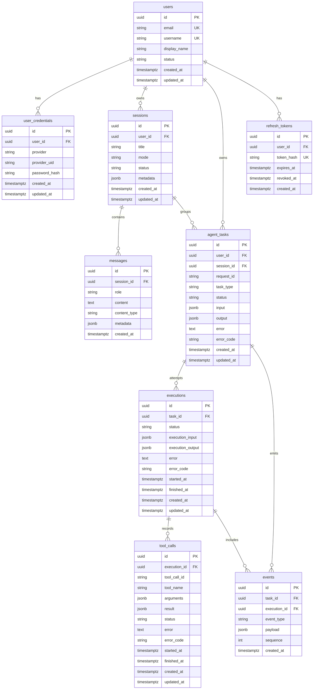

# 数据库 ER

数据库 `muzi_llm` 只给 muzi-llm 使用。主键都是 UUID。JSON 列都是 JSONB。时间列都是 `timestamptz`。

## 约束

| 规则 | 说明 |
|---|---|
| `users.email`、`users.username` | 唯一，并且必须是小写 |
| `user_credentials (provider, provider_uid)` | 第三方身份唯一 |
| `email_password` | `password_hash` 必须以 `$argon2id$` 开头 |
| `github` | `password_hash` 必须为空 |
| `sessions.mode` | `chat` 或 `agent` |
| `users.status` | `active` 或 `disabled` |
| `messages.role` | `user`、`assistant`、`system`、`tool` |
| `agent_tasks.status` | 与现有 `TaskStatus` 一致，含 `limit_reached` |
| `executions.status` | `pending`、`running`、`succeeded`、`failed`、`cancelled` |
| `tool_calls.status` | `running` 加上现有 `ToolExecutionStatus` |
| `events (task_id, sequence)` | 唯一，`sequence >= 1` |
| `refresh_tokens.token_hash` | 64 位小写十六进制，唯一 |
| 执行耗时 | `finished_at - started_at`，不另存一列 |

ORM 属性不能叫 `metadata`。会话和消息的 JSON 列映射为 `metadata_json`，数据库列名仍是 `metadata`。任务输入输出映射为 `input_payload` 和 `output_payload`。

工具参数、工具结果、任务输入输出、执行输入输出和事件载荷在写入前去掉密码、Token 和密钥字段。对话正文不在这条链路里改写。

## 外键

| 子表 | 父表 | 删除行为 |
|---|---|---|
| `user_credentials` | `users` | CASCADE |
| `refresh_tokens` | `users` | CASCADE |
| `sessions` | `users` | RESTRICT |
| `agent_tasks` | `users` | RESTRICT |
| `agent_tasks` | `sessions` | RESTRICT |
| `messages` | `sessions` | CASCADE |
| `executions` | `agent_tasks` | CASCADE |
| `tool_calls` | `executions` | CASCADE |
| `events` | `agent_tasks` | CASCADE |
| `events` | `executions` | CASCADE |

要删除用户，先删除其会话和任务。删除会话前不能还留着关联任务。
