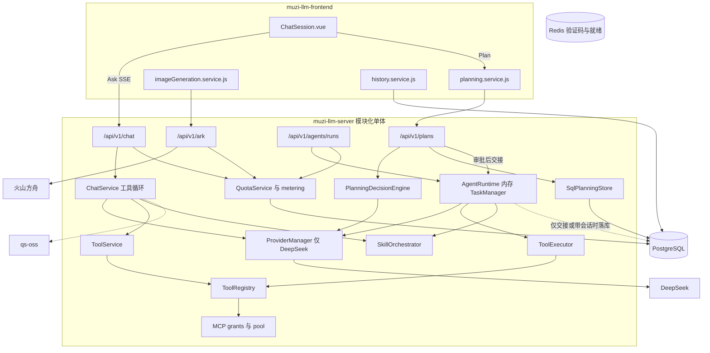

**推荐方案 B：在现有仓库内重组 Conversation、Run 和 Gateway，保留认证、工具、MCP、Skill、计费和数据库。** 不新建后端，不迁走现有库，不重写前端。三条执行链已经能共用模型和工具注册表，但运行状态互不兼容，只在旁边加协议会把双轨留下来。

审计对象是当前工作区，含未提交改动。未跑测试，未对真实数据库执行迁移。

### 1. 当前工程架构概览

工作区不是 Git 仓库。可访问的是三个目录：

| 工程 | 入口 | Git |
|---|---|---|
| `muzi-llm-server` | `app/main.py`，`uvicorn app.main:app` | `main`，跟踪 `origin/main`；未提交 `app/api/v1/endpoints/ark.py`、`app/authorization/application/usage_turns.py`、`app/metering/attribute.py`、`tests/test_ark_files.py`。HEAD `b36bba5` |
| `muzi-llm-frontend` | `src/main.js`（Vue 3 + Pinia + Router） | `main`，跟踪 `origin/main`；对话、用量、管理页有未提交改动，`src/services/` 未跟踪。HEAD `8b38f36` |
| `qs-oss` | `main.py`，独立 FastAPI 上传服务 | 无 Git |

后端业务包：`api`、`services`、`chat`、`planning`、`agents`、`providers`、`tools`、`mcp`、`skills`、`metering`、`authorization`、`models`。ORM 是 SQLAlchemy 2 async。迁移在 `muzi-llm-server/alembic/versions/`，18 个版本、单链、头版本 `b3e7a1c94d20`。PostgreSQL 与 Redis 由 `muzi-llm-server/deploy/docker/docker-compose.yml` 启动。没有 Celery/ARQ，也没有独立 Worker 进程。后端测试约 70 个文件；前端 `package.json` 没有测试脚本，也没有测试文件。

`muzi-llm-server/README.md` 仍写着「对话与 Agent 互不调用、只有两个工具」，和当前代码不符。`muzi-llm-frontend/docs/ARCHITECTURE.md` 仍写路由没有登录墙，当前 `src/router/routes.js` 已有登录、连接器、用量和管理页。

实线是已核对调用，虚线是同进程旁路或未作为统一运行时使用的存储。

前端 `src/modules/conversation/constants/chatModes.js` 把 Agent 模式关掉了。后端交接接口仍在。

### 2. 核心能力现状

| 模块 | 当前状态 | 复用价值 | 主要问题 | 代码证据 |
|---|---|---|---|---|
| Ask | IMPLEMENTED | 高 | 工具循环写在对话服务里，和 Agent 执行器分开 | `app/services/chat_service.py` 的 `_iter_ask_sse`；`app/api/v1/endpoints/chat.py` |
| Plan | IMPLEMENTED | 高 | 规划引擎独立于 Ask/Agent 循环；前端 Agent 交接已关闭 | `app/planning/runtime.py` 的 `PlanningDecisionEngine`；`chatModes.js` 中 `AGENT_MODE_ENABLED = false` |
| Agent | PARTIAL | 中 | 任务在进程内存；重启不可查；UI 关闭，API 仍可创建 | `app/agents/task_manager.py` 写明重启不保留；`app/agents/runtime.py`；`app/api/v1/endpoints/agents.py` |
| Run | PARTIAL | 中 | 三套标识和状态：聊天 `run_id`、Agent `task_id`、Plan 序号事件 | `app/chat/run_registry.py`；`app/agents/models.py`；`app/planning/contracts.py` |
| Provider | PARTIAL | 中 | 只有 DeepSeek 适配器；方舟聊天和图片绕过该接口 | `app/providers/manager.py`；`app/api/v1/endpoints/ark.py` |
| Tool / MCP / Skill | IMPLEMENTED | 高 | 两个执行器；`ExecutionGuard` 已写但没有调用点 | `app/tools/registry.py`；`app/agents/executor.py`；`app/services/tool_service.py`；`app/mcp/`；`app/skills/` |
| Interaction | PARTIAL | 高 | Plan 已有协议、落库、幂等和按序号恢复；Ask/Agent 未复用 | `app/planning/contracts.py`；`app/models/planning.py`；`app/planning/sql_store.py` |
| Billing | PARTIAL | 高 | 结算键可防重复扣减；额度按 Token；预留/释放/退款只有表约束 | `app/authorization/application/audit_service.py` 的 `settle`；`app/models/metering.py`；`app/metering/persist.py` 只写 `consume` |
| Data / Worker | PARTIAL | 高 | 库和迁移可继续用；异步执行不跨进程；两套会话表 | `deploy/docker/docker-compose.yml`；`app/models/tables.py` 的 `sessions` 与 `chat_history_sessions` |

### 3. 架构适配评分

| 维度 | 分 | 证据 |
|---|---|---|
| 模块边界清晰度 | 3 | 包已按 provider、tool、mcp、skill、planning、metering 分开。`chat_service.py` 约 62KB，`ChatSession.vue` 约 182KB，对话、规划和工具循环叠在一起 |
| Ask / Plan / Agent 可整合性 | 3 | 三者都调用同一个 `LLMProvider`。Ask 用 `ChatService`，Plan 用 `PlanningDecisionEngine`，Agent 用 `AgentRuntime`。Plan 交接在 `planning.py` 的 `authorize_execution` |
| Run 体系可扩展性 | 2 | 有取消，没有暂停/恢复实现。`paused` 只出现在计划状态枚举。`ToolCallRecord` 只有模型定义，没有写入 |
| Provider 可扩展性 | 2 | `LLMProvider` 只覆盖聊天补全。模型列表来自配置白名单 `app/api/v1/endpoints/models.py`。图片走方舟 HTTP 转发 |
| Tool / MCP / Skill 可复用性 | 4 | 同一 `ToolRegistry`。MCP 有用户 grant 和连接池。Skill 同时挂到 Chat 和 Agent。执行器有两份 |
| Interaction 可复用性 | 3 | 交互 Schema、提交、幂等键、`plan_events` 按序号读取都已落地。Ask/Agent 没有这条协议 |
| Billing 可扩展性 | 3 | `usage_records` 与 `llm_usage_records` 都有结算唯一键。`model_pricing_versions` 可按时间取价。图片仍折算进 Token 额度；视频前端直接提示未接入 |
| 数据层兼容性 | 3 | Alembic 单头。PostgreSQL 存业务，Redis 用于短信验证码和就绪检查，不存运行队列。会话身份分成 `sessions` 和 `chat_history_sessions` |
| 测试与迁移安全性 | 3 | 后端覆盖 chat、agent、planning、mcp、skill、metering、database。前端无自动化测试。本次未执行测试，也未对库验证迁移 |
| 部署与运维可演进性 | 3 | 已经是单进程模块化单体，适合以后加 Worker。当前 Agent 循环和短信回执都是进程内 `asyncio` 任务，Compose 只包含数据库 |

总分 **29 / 50**。这个分数说明应重组执行核心，不说明要另起平台。

### 4. 关键架构问题

1. **三条执行链状态不兼容**  
   Ask 的 `ChatRunRegistry` 只活在当前进程，用来取消 SSE。Agent 的 `TaskManager` 也在内存，注释写明不能跨进程查询。Plan 的事件在 PostgreSQL 里按序号保存。交接时才会写 `agent_tasks` / `executions` / `events`。`tool_calls` 表没有业务写入。  
   影响 Ask、Plan、Agent 的统一恢复。严重程度高。不阻止渐进改造，但阻止「只加一层协议、三条循环继续各写各的状态」。

2. **两套会话身份**  
   规划用 `sessions` / `messages`（`SqlPlanningStore`）。浏览器历史用 `chat_history_sessions`（`history_service.py`）。用量关联同时接受 `conversation_id` 和 `chat:{history_chat_id}`（`chat.py` 的 `_usage_conversation_id`）。  
   影响 Run、Usage 和前端恢复。严重程度高。不阻止改造，但统一 Run 之前必须先定主键。

3. **方舟绕过 Provider**  
   `ProviderManager.startup` 只构造 `DeepSeekProvider`。`ark.py` 用 httpx 直接请求聊天、图片和文件，再调用同一套 `settle_in_new_session`。视频在 `ChatSession.vue` 里只插入「正在接入」文案。  
   影响图片、视频、音频能力扩展。严重程度中高。不阻止改造；应收入适配器，而不是再复制一个网关。

4. **执行权限没有收口**  
   `execution_guard.py` 定义了 `ExecutionGuard`，仓库内没有 `ExecutionGuard(` 调用。带 `conversation_id` 时，聊天检查 `chat.access`，Agent 检查 `agent.execute`。不带会话时，数据库就绪只检查登录和额度（`agents.py`、`chat.py`）。工具实际门槛是 `risk_level == "low"` 加工具集白名单。  
   影响 Agent 与工具权限。严重程度中。不阻止架构选择，统一 Run 前应先补上。

5. **计费是 Token 额度，不是可扩展账本**  
   `QuotaService.settle` 用 `user_id + source + settlement_key` 防止重复入账。`quota_transactions.action` 允许 `reserve`、`release`、`refund`，写入点只有 `persist.py` 的 `consume`。价格版本表在，没有预留再结算。图片张数记在用量上下文里，扣减单位仍是 Token。  
   影响非 Token 计费。严重程度中。表可以扩展，不必换库。

未发现必须推倒数据库才能解开的循环依赖。`agents/persistence.py` 引用规划存储，规划接口再启动 `AgentRuntime`，这是交接耦合，可以放进统一 Run，不必拆服务。

### 5. 三种路线对比

|  | A 渐进抽取 | B 重组执行核心 | C 旁路新建内核 |
|---|---|---|---|
| 现有功能复用 | 高。入口和表都留着 | 高。认证、工具、MCP、Skill、规划协议、额度表留下 | 中。成熟模块要再做适配层，短期重复一份运行时 |
| 改动范围 | 中。新增协议后逐个入口迁移，三套循环会并存一段时间 | 中高。集中在对话服务、Agent 运行时、规划引擎和方舟入口 | 高。新内核加上旧 API 兼容，直到流量迁完 |
| 数据迁移 | 低。加表或加列 | 低。沿用 Alembic，把现有任务、事件、用量键对齐 | 中。双库或双写，直到旧表停用 |
| 兼容风险 | 中。双轨期间结算键和会话键容易写岔 | 中。重组面集中，可用旧接口做兼容 | 高。两套运行状态同时在线 |
| 测试成本 | 中。后端已有测试，前端没有 | 中。要补 Run 契约测试；前端仍缺自动化 | 高。新旧契约都要守 |
| 开发复杂度 | 中。短期小，双轨拖久了变高 | 中。边界已经存在，缺的是统一生命周期 | 高。等于再实现一套已测过的工具、MCP、Skill 和额度 |
| 长期可维护性 | 中。巨文件不拆开会继续堆 | 高。执行核心只有一套，能力层继续加 | 高，但要先付双系统成本 |
| 主要阻断 | 三套状态若一直共存，Run 统一完不成 | `ChatSession.vue` 和两套会话键必须一起收 | 没有证据表明旧内核无法演进；新建会把已测能力再写一遍 |

### 6. 最终架构判断

**推荐 B。** 复用最多、又能去掉三套执行状态。A 的第一段工作和 B 相同，但如果三条循环继续各自持久化，后面每次加图片、暂停或恢复都要改三处。C 要等现有能力明显无法承载目标时才成立；现在的工具、MCP、Skill、规划交互和结算键都不满足这个条件。

- **必须保留：** 认证与 RBAC、`QuotaService` 结算键、`ToolRegistry`、MCP grant/pool、Skill 注册与编排、规划交互契约和 `plans` / `plan_events`、Alembic 与 PostgreSQL、前端规划卡片和用量页。
- **值得重组：** `ChatService` 工具循环、`AgentRuntime`、`PlanningDecisionEngine` 的模型调用、方舟入口、`sessions` 与 `chat_history_sessions` 的身份关系、两套 SSE（`core/sse.py` 与 `agents/events.py`）。
- **需要新建：** 统一的 Run 生命周期（可落在现有 `agent_tasks`、`executions`、`events`、`llm_usage_records` 上，而不是另起一套库）；聊天/图片/视频的 Capability 适配；非 Token 的预留与结算。当前没有这三样的统一实现。
- **不需要新建后端工程。** 继续放在 `muzi-llm-server`。
- **不需要迁走数据库。** 扩展现有表和迁移链。
- **不需要重写前端。** `ChatSession.vue` 要变薄，页面、路由和规划组件留下。
- **最大技术风险：** 把三条循环收成一个 Run 时，弄断 Plan 的幂等提交，或让同一次模型调用写出两套用量键。Agent 进程内任务在重组完成前仍然不能靠重启恢复。

### 7. 下一步建议

1. **定会话主键并做键映射**  
   目标：让一次用户对话只对应一个可追踪身份。  
   模块：`sessions`、`chat_history_sessions`、`llm_usage_records`、前端 `conversation.store.js`。  
   结果：一张字段对照，标明 Ask、Plan、历史同步、用量各自读写哪一列。  
   验收：现有 Ask 与 Plan 请求都能落到同一个会话标识，不改用户可见行为。

2. **做最小 Run 记录，先接 Ask 和 Plan**  
   目标：同一次模型调用留下同形的运行、步骤和事件，旧接口响应保持不变。  
   模块：`chat.py`、`chat_service.py`、`planning/sql_store.py`、`metering/persist.py`。Agent 只定义适配接口，先不改内存任务语义。  
   结果：Ask 流和 Plan 消息各写出一条可按标识读回的运行记录，并带上现有 `settlement_key`。  
   验收：重复提交不产生第二笔额度；Plan 事件序号恢复仍可用。

3. **把方舟收进 Provider 适配器，并补上执行权限缺口**  
   目标：聊天和图片走同一适配接口；Agent 创建无论是否带会话都检查 `agent.execute`。  
   模块：`providers/`、`ark.py`、`agents.py`、`execution_guard.py`。  
   结果：图片生成仍经 `settle_in_new_session` 入账；端点不再直接拼上游 HTTP。  
   验收：无会话的 Agent 创建在数据库就绪时被权限拒绝；图片用量仍只记一笔。

审计到此停止，未改任何代码、配置或 Git 状态。
